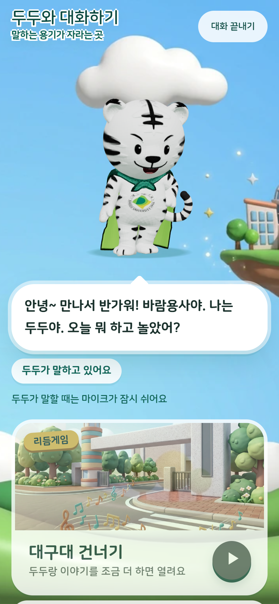
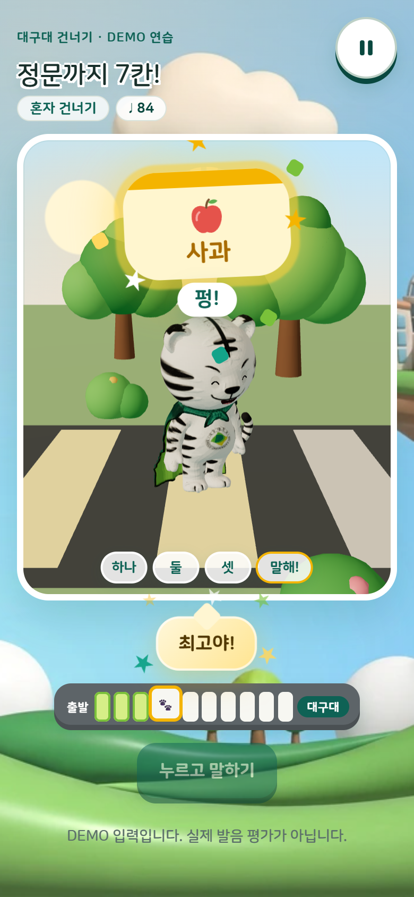
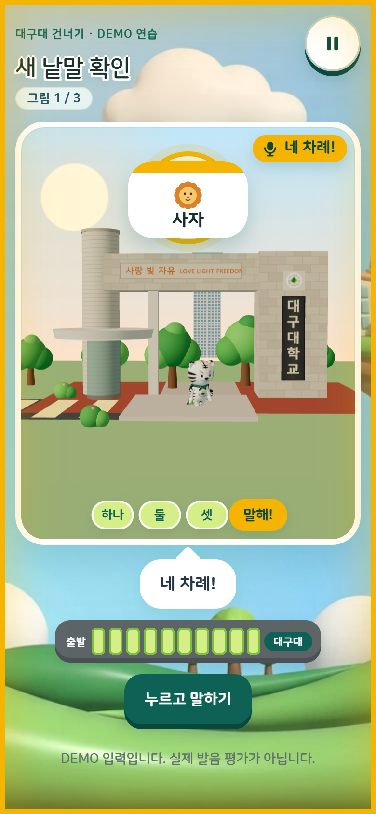
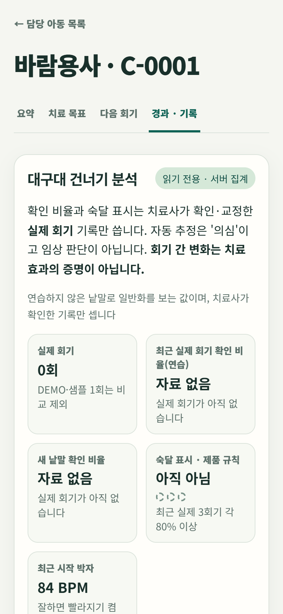

# Speech Hero

**두두와 말하며 연습하고, 치료사가 근거를 확인하는 언어치료 보조 웹 앱입니다.**

만 4~7세 아동이 그림·박자 게임으로 어두 /ㅅ/를 연습하고, 언어치료사는 그 기록을 확인·교정해 다음 회기를 정합니다.

> 게임의 칭찬과 서버의 음향 자동 추정은 임상 판단이나 진단이 아닙니다. 불확실·무발화는 실패로 세지 않고, 확인 자료가 없으면 ‘자료 없음’으로 표시합니다.

| 두두와 대화 | 대구대 건너기 | 새 낱말 확인 | 치료사 경과 · 기록 |
|:---:|:---:|:---:|:---:|
|  |  |  |  |

## 1. 전체 흐름 한눈에 보기

```
아동 화면 ──(소리 측정·인식 문장)──▶ FastAPI 서버 ──▶ SQLite 기록
   ▲                                   │                  │
   └──────(다음 카드·진행 상태)──────────┘                  ▼
                                               치료사 화면: 확인·교정 → 다음 회기 계획
```

1. **두두와 대화** — 아이 말에 반응하며 /ㅅ/ 낱말을 유도합니다. 서버가 대화 전략과 게임 전환 시점을 정합니다.
2. **대구대 건너기** — ‘똑·똑·똑’ 다음 넷째 박에 카드 낱말을 말합니다. 한 판 5라운드 × 2줄, 같은 회기에서 최대 3판.
3. **새 낱말 확인** — 연습하지 않은 낱말 최대 3개를 칭찬·정오 없이 확인합니다. 연습 집계와 섞지 않습니다.
4. **치료사 검토** — 자동 추정의 근거와 음질을 보고 확인·교정하고, 연습과 새 낱말 확인을 따로 봅니다.
5. **다음 회기 계획** — 확인된 근거로 서버가 제안 → 치료사가 수정·승인합니다. 게임 단계는 대구대 건너기 하나이고, 목표가 어두 /ㅅ/(음절·낱말)일 때만 들어갑니다. (승인 계획을 게임에 자동 적용하는 기능은 아직 없습니다.)

예전 모험 게임 4종(빛의 마법·하늘 오르기·몬스터 모험·두두와 소풍)과 두두의 집·지도·보상·매직빔 승인은 2026-11-19에 삭제했습니다. 변경 내용은 [동결 계약 15절](documents/02_architecture/FROZEN_CORE_CONTRACT.md)에 있습니다.

### 소리 한 번이 기록이 되기까지

| 단계 | 어디서 | 파일 |
|---|---|---|
| 마이크 프레임 측정, 잡음 보정, 발화 시작·끝 | 브라우저 | `src/speech/` |
| 시작 마찰·뒤 유성 구간 요약(원음은 보내지 않음) | 브라우저 | `src/game/crossing/onsetPipeline.ts` |
| 결과 판정: 성공·다시·불확실·무발화 | 서버 | `backend/app/games/evaluation.py` |
| 진행(라운드·줄·판·새 낱말 확인) | 서버 | `backend/app/games/crossing.py` |
| 관찰 기록 생성 | 서버 | `backend/app/clinical/observation_builder.py` |
| 치료사 확인·교정, 분리 집계 | 서버 | `backend/app/therapist_api.py`, `backend/app/therapist_insights/` |
| 다음 회기 제안(LangGraph 6단계) | 서버 | `backend/app/therapist_planning/` |

판정 기준(시작 마찰 60ms·뒤 유성 80ms·SNR 15dB)은 성인 1명 측정으로 정한 임시 제품 기준입니다. 근거와 이력은 [HEURISTIC_REGISTER](documents/02_architecture/HEURISTIC_REGISTER.md)에 있습니다.

## 2. 폴더 구조

```
├─ index.html                 앱 진입점
├─ dudu-review.html           (개발용) 두두 3D 동작 검토 화면
├─ voice-mic-check.html       (개발용) 실기기 마이크·목소리 점검 화면
├─ src/                       프런트엔드 (React + TypeScript)
│  ├─ main.tsx, App.tsx       시작점과 화면 경로
│  ├─ pages/                  첫 화면(Landing)
│  ├─ api/                    서버 호출 (client, auth=CSRF 토큰, 활동·대화·치료사 API)
│  ├─ child/                  아동 화면: 로그인(PlayEntry), 대화(HoyaChat), 건너기(DaeguCrossing), 마무리(DuduGoodbye)
│  ├─ game/crossing/          건너기 규칙: 박자, 판정 연결, 다시 시도 도움말
│  ├─ speech/                 마이크·음향 측정·음성 인식·두두 목소리
│  ├─ control/                게임 종류(GameKind)·두두 동작(HoyaAction) 이름 타입
│  ├─ tiger/                  두두 3D 캐릭터
│  ├─ therapist/              치료사 화면: 목록, 아동 상세, 분석, 계획
│  ├─ shared/                 공용 타입·훅(데모 모드, 움직임 줄이기)
│  ├─ dev/                    개발용 마이크 점검 화면(voice-mic-check.html)
│  ├─ build/                  빌드 시 보안 정책(CSP) 생성
│  └─ styles/                 CSS (tokens.css는 생성 파일)
├─ backend/                   백엔드 (FastAPI + SQLAlchemy + SQLite)
│  ├─ app/main.py             앱 생성·보안 미들웨어·로그인·아동 놀이 API
│  ├─ app/therapist_api.py    치료사용 API (아동·목표·회기·관찰)
│  ├─ app/serializers.py      DB 행 → API 응답 변환 공용 함수
│  ├─ app/games/              건너기 라운드 정의·판정·진행
│  ├─ app/clinical/           발화 결과 → 임상 관찰 기록
│  ├─ app/pronunciation/      음향 요약 입력 형식·음질 등급
│  ├─ app/adventure/          활동 이어받기(lease)·활동 응답 형식 (이름은 예전 모험 기능에서 유래)
│  ├─ app/game_settings/      아동별 박자 설정 (api + service)
│  ├─ app/hoya/               두두 대화 (정책·LLM 제공자·검증)
│  ├─ app/therapist_insights/ 치료사 읽기 전용 분석
│  ├─ app/therapist_planning/ 다음 회기 계획 (LangGraph)
│  ├─ app/training/           목표 소리별 연습 낱말 은행
│  ├─ app/speech/pipeline.py  인식 문장 음소 분석 (지금은 앱에서 쓰지 않음, 동결 인터페이스라 유지)
│  ├─ app/...                 그 밖의 모듈은 파일 맨 위 설명 참고
│  ├─ scripts/                smoke 검사·시연 DB·계정 생성 도구
│  └─ tests/                  pytest
├─ shared/                    프런트·백엔드가 함께 읽는 JSON 기준 자료
├─ public/assets/             앱이 직접 제공하는 그림·음성·3D 모델·글꼴
├─ scripts/                   빌드 검사·디자인 토큰·음성 파형 생성·휴대폰 시험 서버
├─ assets/dudu3d/             두두 3D 모델 제작 원본과 도구
└─ documents/                 설계·근거·기록 문서 (실행에는 필요 없음)
```

**코드를 처음 읽는다면 이 순서를 추천합니다.**
1. `src/App.tsx` → 어떤 화면이 있는지
2. `src/child/DaeguCrossing.tsx` → 게임이 서버와 주고받는 흐름
3. `backend/app/main.py` → 아동 활동 API와 라운드 진행
4. `backend/app/games/evaluation.py`, `games/crossing.py` → 판정과 진행 규칙
5. `backend/app/therapist_api.py` → 치료사가 기록을 확인하는 API

`backend/app`의 모든 파일과 함수에는 무엇을 하는지·왜 있는지 한국어 설명이 붙어 있습니다.

### 바꿀 때 주의할 점

- `backend/app/hoya/prompt/system_prompt.md`와 루트 `shared/`는 코드가 경로로 읽으므로 위치를 옮기지 않습니다.
- `shared/*.json`을 고치면 프런트(`npm test`)와 백엔드(`pytest`) 테스트를 둘 다 돌립니다.
- `src/styles/tokens.css`, `shared/dudu_voice_envelopes.json`은 `scripts/`가 만드는 파일이라 직접 고치지 않습니다.
- 마이크·인증·대화 API 같은 핵심 경로는 [동결 계약](documents/02_architecture/FROZEN_CORE_CONTRACT.md)을 먼저 확인합니다.
- `.github/README.md`를 만들면 GitHub 첫 화면에서 이 README를 가리므로 만들지 않습니다.

## 3. AI와 음성 기술

| 기술 | 하는 일 | 하지 않는 일 |
|---|---|---|
| Web Audio · VAD | 음량·발성 시간·마찰음·잡음 측정 (건너기는 이것만 사용) | 혀 위치나 /ㅅ/·/ㅆ/ 차이 확정 |
| Web Speech API | 대화에서 한국어 인식 문장 생성 | 틀린 발음을 표준어로 고쳐 적을 수 있어 정오 판단에 쓰지 않음 |
| OpenAI Responses (선택) | 서버가 정한 전략에 맞는 대화 문장, 계산된 지표의 요약 문장 | 발음 판정·수치 계산·목표 변경 |
| LangGraph | 근거 조회 → 필터 → 지표 계산 → 제안 → 요약 → 검증 | 요약 단계만 LLM, 나머지는 Python 규칙 |
| VOLI 음성 · 브라우저 TTS | 미리 녹음한 두두 음성, 없으면 브라우저 음성 | 새 낱말 확인 단계에서는 안내 음성 없음 |

- **원칙:** 서버가 계산하고, AI는 설명하고, 결정은 치료사가 합니다.
- 두 LLM 경로는 **기본 꺼짐**입니다. 실패·시간 초과·검증 실패면 DEMO 대본이나 템플릿으로 바로 대체합니다.
- 대화에는 인식 문장·최근 대화·목표가 전송되며, 아이가 말한 개인정보가 들어갈 수 있으므로 보호자 동의 아동만 사용합니다. 치료사 요약에는 이름·ID·인식 문장을 보내지 않습니다.
- 학습형 아동 발음 모델은 적합한 라벨 데이터가 없어 만들지 않았습니다([연구 결론](documents/06_research/pronunciation_final.md)).

## 4. 빠른 시작 (Windows PowerShell)

필요: Node.js 22.12 이상, Python 3.14(CI 기준). 실제 마이크는 HTTPS 또는 localhost에서만 동작합니다.

```powershell
# 1) 의존성 설치 (저장소 루트)
npm.cmd ci
cd backend
python -m venv .venv
.venv\Scripts\python.exe -m pip install -r requirements.txt

# 2) 백엔드 실행 (외부 LLM 끈 DEMO 설정)
New-Item -ItemType Directory -Force test-temp | Out-Null
$env:DATABASE_URL = 'sqlite:///./test-temp/readme-demo.db'
$env:SEED_DEMO_DATA = 'true'
$env:COOKIE_SECURE = 'false'
$env:HOYA_CHAT_ENABLED = 'false'
$env:THERAPIST_SUMMARY_ENABLED = 'false'
.venv\Scripts\python.exe -m uvicorn app.main:app --host 127.0.0.1 --port 8000
```

```powershell
# 3) 프런트엔드 실행 (다른 터미널, 저장소 루트)
npm.cmd run dev -- --port 5173 --strictPort
```

- 화면: http://127.0.0.1:5173 · API 문서: http://127.0.0.1:8000/docs
- 로그인 화면의 ‘DEMO 아동으로 시작’·‘DEMO 치료사로 시작’을 누릅니다. 샘플 회기 기록은 바람용사(C-0001, /ㅅ/)에만 있습니다.
- 마이크 없이 건너기를 보려면 ‘DEMO로 시작(누르고 말하기)’ 후 `Space`를 누릅니다.
- AI 대화·요약을 켜려면 [backend/.env.example](backend/.env.example)을 `backend/.env`로 복사해 `HOYA_CHAT_ENABLED=true`, `THERAPIST_SUMMARY_ENABLED=true`, 모델 이름, `OPENAI_API_KEY`를 넣습니다. 키는 서버 환경에만 둡니다.
- 운영 계정 만들기: `backend`에서 `.venv\Scripts\python.exe -m scripts.provision_account`
- 시연 DB·휴대폰 HTTPS 연결: [시연 진행표](documents/05_demo/DEMO_RUNSHEET_2026-10-05.md)

## 5. 검사

```powershell
npm.cmd run typecheck
npm.cmd test
npm.cmd run build
backend\.venv\Scripts\python.exe -m pytest backend/tests -q -p no:cacheprovider --basetemp backend/test-temp/ci
backend\.venv\Scripts\python.exe backend/scripts/smoke_api.py http://127.0.0.1:8000
```

현재 결과: 프런트 39개 파일 291개 테스트, 백엔드 503개 테스트 통과. 자동 테스트는 코드 회귀 검사이며 임상 정확도를 뜻하지 않습니다. [CI](.github/workflows/ci.yml)는 PR과 `main` push에 같은 검사를 실행합니다.

**아직 하지 않은 것:** 최신 버전의 실제 휴대폰·마이크 전체 리허설, 아동 음성 정확도·임상 평가, 운영 환경 준비(브랜치 보호·DB 마이그레이션). 우선순위는 [로드맵](documents/01_overview/ROADMAP.md)에 있습니다.

## 6. 개인정보와 보안

- 로그인은 HttpOnly·SameSite 쿠키, 변경 요청은 CSRF 값과 Origin을 검사합니다. 역할·담당 아동 소유권은 서버가 확인합니다.
- **원본 음성 파일은 서버에 저장하지 않습니다.** 인식 문장·음향 요약·회기 기록은 저장되며, 인식 문장 등은 기본 90일 뒤 비웁니다.
- 개발용 샘플 계정은 `SEED_DEMO_DATA=true`일 때만 켜지며 운영에 쓰지 않습니다.

## 7. 주요 API

| 경로 | 용도 |
|---|---|
| `/api/auth/login`, `/api/auth/logout` | 쿠키 로그인 |
| `/api/hoya/chat/sessions` | 두두 대화 시작·턴·완료 |
| `/api/activities`, `/api/activities/{id}/utterances` | 활동 시작, 발화 요약 제출 |
| `/api/activities/{id}/laps`, `/api/activities/{id}/probes` | 판 반복, 새 낱말 확인 시작 |
| `/api/play/sessions/{id}/complete` | 회기 마무리 |
| `/api/sessions/{id}/timeline`, `/api/sessions/{id}/clinical-summary` | 회기 관찰·임상 요약 |
| `/api/therapist/children/{id}/crossing-analytics` | 연습·새 낱말 확인 분리 집계 |
| `/api/therapist/children/{id}/game-settings` | 시작 박자·빨라지기 설정 |
| `/api/observations/{id}/decision` | 치료사 확인·교정·거부 |

전체 목록은 서버 실행 후 `/docs`에서 볼 수 있습니다.

## 8. 문서 (`documents/`)

| 폴더 | 내용 |
|---|---|
| [01_overview](documents/01_overview/) | 로드맵, 구조도·화면 이미지 |
| [02_architecture](documents/02_architecture/) | 시스템 구조, 치료사 업무 흐름, 동결 계약, 임시 기준값 |
| [03_clinical](documents/03_clinical/) | 건너기 설계 근거, 임상 근거, 근거 출처 |
| [04_history](documents/04_history/) | 작업 기록, 결정 기록, 감사 기록, V2 원문 |
| [05_demo](documents/05_demo/) | 시연 진행표, 마이크 측정 |
| [06_research](documents/06_research/) | 한국 아동 발음 데이터 연구 |
| [07_assets_production](documents/07_assets_production/) | 자산 라이선스, 두두 음성 제작 기록 |
| [08_poster](documents/08_poster/) | 포스터 검토본과 문안 |

두두 3D 모델 제작 과정은 [assets/dudu3d/README.md](assets/dudu3d/README.md)에 있습니다.
